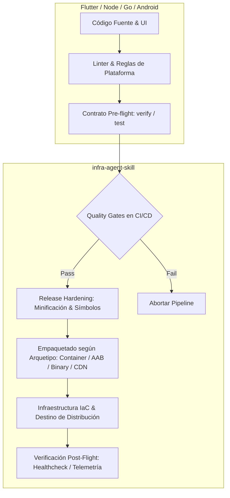

# 🏗️ Infra Agent Skill (Transversal)

> **Habilidad Transversal de Infraestructura, CI/CD, Release Engineering, Containerización y Despliegue Agnóstico** para Agentes de Inteligencia Artificial (Antigravity, Cursor, Claude, OpenAI, Gemini).

Diseñada bajo el principio de **100% agnosticismo transversal** para operar sobre cualquier plataforma (**Flutter, Node/TypeScript, Python, Go, Rust, C++, C# Game Engine**).

---

## 📌 Propósito y Alcance Transversal

`infra-agent-skill` provee a los agentes de IA un núcleo de ingeniería de infraestructura desacoplado del dominio de aplicación:

1. **🛡️ Aislamiento de Frontera Transversal (Domain Shield)**:
   - La infraestructura **no audita ni acopla** layouts, widgets de UI, insets de SO (ej. Android 15 Edge-to-Edge, SafeAreas) ni lógica de negocio. Esas validaciones pertenecen a las habilidades de plataforma.
   - La infraestructura **define y exige el contrato de compuertas pre-flight** (`lint`, `test`, `security`). Si la plataforma reporta fallos, el pipeline detiene el release.
2. **🔒 Release Hardening & Optimización Obligatoria**:
   - Auditoría estricta pre-compilación: bloqueo de distribución a producción si las banderas de optimización (minificación, dead code elimination, tree-shaking, stripping) están desactivadas.
   - Gestión y archivo de símbolos de depuración (mapping.txt, dSYMs, sourcemaps) para observabilidad de crashes sin exponerlos en artefactos públicos.
   - Verificación de contratos de preservación (keep rules / reflexión) para evitar roturas en runtime por ofuscación.
3. **📦 Empaquetado Multiarquetipo**:
   - **Servicios / APIs**: Docker multi-stage optimizado por capas y usuarios no-root.
   - **Clientes / Mobile / Games**: Runners reproducibles, inyección segura de llaves y bundles de distribución.
   - **CLIs / Librerías**: Binarios estáticos con stripping o paquetes limpios sin dependencias de desarrollo.
   - **Web Estática / CDN**: Inmutabilidad y content-hashing para cache-busting.
4. **🔄 Pipelines CI/CD & Secretos**:
   - Automatización en GitHub Actions, GitLab CI, etc., con aislamiento de variables y credenciales.
5. **🚀 Despliegue Seguro & Verificación Post-Flight por Arquetipo**:
   - Rollout progresivo (Canary, Blue/Green, Staged Rollout en tiendas).
   - Verificación adaptada: HTTP `/health` para APIs, telemetría y tasa de crashes para clientes/mobile, smoke-tests para CLIs.

---

## ⚡ $-Comandos de Infraestructura

| Comando | Acción | Descripción |
|---|---|---|
| `$infra` | **Bootstrap Infra** | Inicializa el contexto de infraestructura y valida la postura transversal del proyecto. |
| `$infra:check` / `$infra:audit` | **Diagnóstico Integral** | Audita compuertas CI/CD, release hardening, empaquetado, secretos e IaC. |
| `$infra:hardening` | **Release Hardening** | Verifica flags de optimización, minificación y archivo de símbolos de depuración. |
| `$infra:cicd [target]` | **Pipeline CI/CD** | Construye o refactoriza workflows con contratos de compuertas pre-flight agnósticas. |
| `$infra:docker [target]` | **Containerización** | Genera o refactoriza Dockerfiles multi-stage optimizados para servicios. |
| `$infra:iac` | **Provisionamiento** | Crea/actualiza manifiestos Terraform/Ansible con estado remoto seguro y locking. |
| `$infra:deploy` | **Plan de Despliegue** | Diseña e inspecciona la estrategia de despliegue con checklist pre y post-flight. |

---

## 🧩 Arquitectura Transversal y Delimitación



---

## ⚡ Quick Start

**1. Instala la skill como submódulo**
```bash
git submodule add git@github.com:Agent-Rules-Ecosystem/infra-agent-skill.git .skill/infra-agent-skill
```

**2. Activa la skill con `$boot`**
```text
$boot
```

**3. Ejecuta el diagnóstico transversal**
```text
$infra:audit
```
