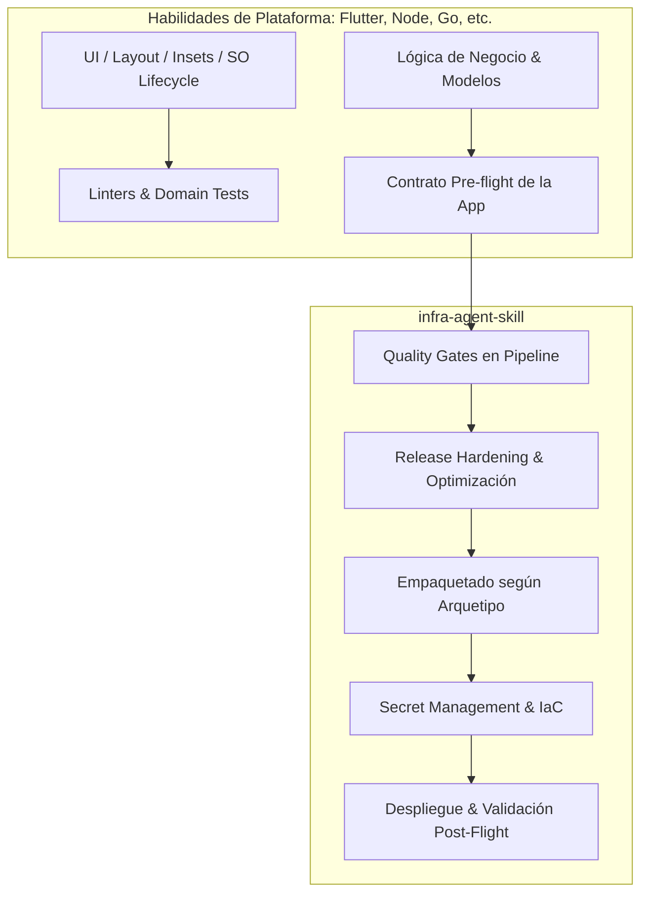
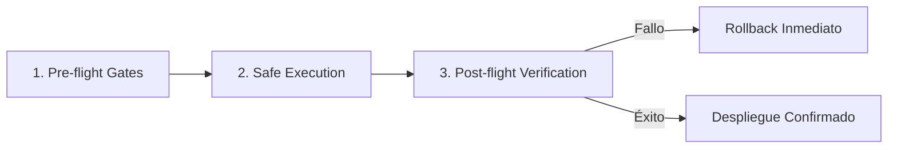

# ⚙️ Infra Agent Skill Matrix & Directives

## 🎯 Capacidades y Frontera Transversal

`infra-agent-skill` es la habilidad de infraestructura, CI/CD, release engineering y despliegue transversal del ecosistema.



### 🛡️ Principio de Aislamiento de Dominio (Domain Shield)
* **Lo que gestiona esta habilidad**: Orquestación de pipelines, compuertas de calidad agnósticas, verificación de optimización/hardening de release, empaquetado seguro, secretos, IaC y despliegue/rollback.
* **Lo que NO pertenece a esta habilidad**: Reglas de UI, widgets, insets del SO (ej. Edge-to-Edge de Android 15, Dynamic Island de iOS), componentes visuales ni lógica de negocio. Esas validaciones residen en la habilidad de la plataforma y son consumidas por la infra como una compuerta (`pre-flight`).

---

## 📋 Protocolo de Diagnóstico de Infraestructura (`$infra:check`)

Al ejecutar `$infra:check` o `$infra:audit`, el agente audita 5 vectores universales:

### 1. Vector CI/CD & Contrato de Quality Gates
- ¿Existe pipeline automatizado (`.github/workflows/`, `.gitlab-ci.yml`, etc.)?
- ¿El pipeline invoca los hooks de la aplicación (`lint`, `test`, `security-audit`) antes de empaquetar?
- ¿El pipeline aborta inmediatamente si una compuerta de la plataforma falla?
- ¿Se aplican permisos mínimos (`permissions: read-all` o específicos) y secretos cifrados?

### 2. Vector Release Hardening & Optimización Obligatoria
- **Perfil de Producción**: ¿Se garantiza que los binarios de release final no usen perfiles o flags de depuración (`debuggable = false`)?
- **Optimización y Minificación**: ¿Están activas las optimizaciones del compilador según la plataforma (minificación de código, eliminación de recursos/código muerto, tree-shaking, stripping de símbolos binarios)?
- **Preservación y Símbolos de Depuración**: ¿Se extraen, archivan y suben los archivos de mapeo/símbolos (mapping.txt, dSYM, sourcemaps) a la plataforma de observabilidad para deofuscación de crashes sin exponerlos en el artefacto público?
- **Reglas de Preservación de Reflexión**: ¿Se verifican las reglas de preservación (keep rules / configuración de serializadores) para evitar que la minificación rompa reflection o deserialización en runtime?

### 3. Vector de Empaquetado según Arquetipo
- **Servicios / APIs**: ¿Existe Dockerfile multi-stage con separación de dependencias y código fuente, y usuario no-root en producción?
- **Clientes / Mobile / Desktop**: ¿La compilación es reproducible y las llaves de firma se inyectan como variables de CI/CD protegidas fuera del repositorio?
- **CLIs / Librerías**: ¿El empaquetado excluye dependencias de desarrollo y genera binarios independientes o paquetes limpios?
- **Assets Estáticos / Web**: ¿Se generan hashes de contenido para cache-busting inmutable?

### 4. Vector de Gestión de Secretos y Configuración
- ¿Existe aislamiento absoluto de secretos (cero tokens, llaves API o certificados en el control de versiones)?
- ¿Se inyecta la configuración en tiempo de ejecución o construcción mediante variables de entorno protegidas?

### 5. Vector de IaC e Infraestructura de Destino
- ¿Los manifiestos de infraestructura (Terraform, Ansible, Compose, Kubernetes) son declarativos e idempotentes?
- ¿El estado remoto cuenta con bloqueo concurrente (locking) y encriptación en reposo?

---

## 🏗️ Matriz Canónica de Empaquetado por Arquetipo

### Arquetipo A: Servicios / APIs (Contenedor Multi-Stage)
```dockerfile
# Etapa 1: Construcción y Compilación
FROM base-builder:tag AS builder
WORKDIR /app
COPY <manifest-dependencies> ./
RUN <install-deps-command>
COPY . .
RUN <build-production-command>

# Etapa 2: Runner Minimalista de Producción
FROM alpine:3.19 OR distroless AS runner
WORKDIR /app
RUN addgroup -S appgroup && adduser -S appuser -G appgroup
COPY --from=builder /app/dist-or-binary /app/
USER appuser
EXPOSE 8080
HEALTHCHECK --interval=30s --timeout=3s --retries=3 \
  CMD <healthcheck-command> || exit 1
ENTRYPOINT ["/app/entrypoint"]
```

### Arquetipo B: Clientes / Mobile / Videojuegos / Desktop
- Construcción en runner aislado con caché de dependencias del SDK.
- Activación obligatoria de optimización de release (minificación / stripping / tree-shaking).
- Separación y archivo de símbolos de depuración para crash reporting.
- Firma criptográfica con credenciales efímeras inyectadas por el entorno de CI.

### Arquetipo C: Herramientas CLI / Librerías / Paquetes
- Compilación con optimización de release y LTO (Link-Time Optimization) o stripping de símbolos de desarrollo.
- Empaquetado de binario independiente o tarball/wheel/npm package sin fuentes innecesarias.

---

## 🔄 Protocolo de Despliegue Seguro Universal



1. **Pre-flight**:
   - Pasar suite de compuertas de calidad (`lint`, `test`, `security`).
   - Validar checklist de Release Hardening (optimización y símbolos de depuración archivados).
   - Verificar sintaxis y estado de la infraestructura o canal de destino.
2. **Execution**:
   - **Servicios**: Despliegue Zero-Downtime (Rolling / Blue-Green / Canary) con migraciones idempotentes de datos.
   - **Clientes / Mobile**: Staged Rollout gradual (ej. 5% -> 10% -> 25% -> 100%) en tiendas o canales de distribución.
   - **Librerías / CLIs**: Publicación atómica bajo versionado semántico inmutable.
3. **Post-flight (Verificación por Arquetipo)**:
   - **Servicios**: Monitoreo de salud durante 120s en endpoint de salud con umbral HTTP 200.
   - **Clientes / Mobile**: Monitoreo de telemetría de crashes (Crashlytics/Sentry crash-free sessions > 99.5%). Si la tasa de fallos se dispara en el rollout inicial, detener la distribución inmediatamente.
   - **CLIs / Librerías**: Smoke-test de ejecución en entorno limpio post-instalación.

---

## 📝 Persistencia y Salida Activa (`overview/work/skill/`)

Al ejecutar esta skill (mediante `$infra`, `$infra:check` o `$infra:audit`), es **obligatorio crear o actualizar su reporte activo** dentro del proyecto cliente en:

`overview/work/skill/infra.md`

### Estructura Requerida del Reporte:

```markdown
# 📋 Registro Activo de Tareas — Infra Agent Skill

> **Generado por**: `infra-agent-skill` (`$infra:audit`)  
> **Última actualización**: YYYY-MM-DD  

## 🎯 Tareas Pendientes Accionables

| ID | Arquetipo | Tipo | Estado | Resumen | Evidencia/Ruta | Acción Requerida |
|---|---|---|---|---|---|---|
| INF-01 | Servicio / Mobile / CLI | Hardening / CI-CD | Pendiente | <Resumen breve> | `<ruta:línea>` | <Remediación agnóstica> |

## 📝 Observaciones y Detalles de Revisión
- Detalle técnico, evidencia de compuertas de calidad o contexto de optimización de release.
```
